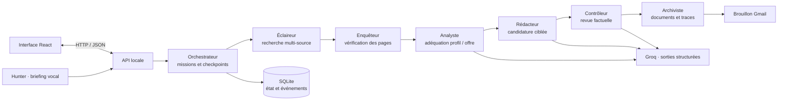
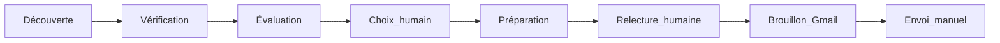

# LevelUp

### Une équipe d’agents IA pour transformer la recherche de stage en un pipeline clair, vérifiable et humainement contrôlé.

<p align="center">
  <a href="https://github.com/EyaDouiri/LevelUp"></a>
  
  
  
</p>

> **Projet portfolio — AI Agent Engineer** · Un cas concret d’orchestration multi-agent avec rôles spécialisés, données vérifiables et validation humaine.

[Dépôt GitHub](https://github.com/EyaDouiri/LevelUp) · [Présentation complète MDX](README.mdx) · [Architecture détaillée](docs/architecture.mdx) · [Démo](docs/demo-agentique-levelup.mdx)

---

LevelUp accompagne une campagne de recherche de stage de fin d’études en Data, IA et actuariat : découverte et vérification d’offres, évaluation du profil, préparation de candidatures et suivi. Les offres et les candidatures spontanées disposent de parcours séparés.

## Architecture multi-agent



| Agent | Rôle dans l’équipe |
|:--|:--|
| **Orchestrateur** | Pilote les missions, les checkpoints et les relais entre agents. |
| **Éclaireur** | Recherche des offres et des entreprises à partir de sources configurées. |
| **Enquêteur** | Vérifie les pages publiques et extrait les informations disponibles. |
| **Analyste** | Évalue l’adéquation d’une offre avec le profil. |
| **Rédacteur** | Prépare le contenu d’une candidature ciblée à partir des preuves du profil. |
| **Contrôleur** | Relit la candidature et bloque les affirmations non étayées. |
| **Archiviste** | Génère les documents et enregistre les résultats. |

**Hunter** résume à la demande l’état de la campagne en français. Il complète l’équipe par une interface vocale.



Les échanges importants sont structurés avec Pydantic et les événements de mission sont consultables dans l’interface. SQLite conserve l’état et permet de reprendre une mission interrompue. **Aucun email n’est envoyé automatiquement** : l’utilisateur relit, complète le brouillon Gmail et décide de l’envoi.

## Fonctionnalités

- Interface React pour les opportunités, l’équipe agentique, les contacts et les entreprises cibles.
- Préparation de CV, lettre et email ; export Excel du suivi.
- Intégration Gmail OAuth pour créer des brouillons après validation.
- Briefing vocal Hunter et journal de mission consultable.

## Démarrage rapide

Prérequis : Python 3.12 recommandé, Node.js et npm.

```powershell
python -m venv .venv
.venv\Scripts\python -m pip install -r requirements.txt
Copy-Item .env.example .env
cd frontend
npm install
npm run build
cd ..
.\start.ps1
```

L’interface est disponible sur `http://127.0.0.1:8000`. Configure dans `.env` les clés des intégrations souhaitées. Gmail est optionnel et nécessite OAuth. Ne partage jamais `.env`, `credentials.json` ni `token.json`.

## Technologies

**Python · React · Vite · SQLite · Pydantic · Groq · Tavily · Adzuna · Jooble · ReportLab · Gmail API**

Les sources de recherche disponibles dépendent de leur configuration et de leur disponibilité. Vérifie les informations avant toute candidature.

## Structure

```text
engine.py                  # Orchestrateur et équipe d’agents
contracts.py               # Contrats structurés
providers.py / research.py # Recherche et vérification
application_documents.py   # CV et lettre en PDF
storage.py / server.py     # Persistance et API locale
frontend/                  # Interface React
docs/                      # Architecture, guides et démonstration
tests/                     # Tests unitaires et d’interface
```

Pour l’architecture et le parcours de démonstration, consulte la [présentation complète](README.mdx).

**Développé par Eya Douiri · Tunisie** · [EyaDouiri/LevelUp](https://github.com/EyaDouiri/LevelUp)
