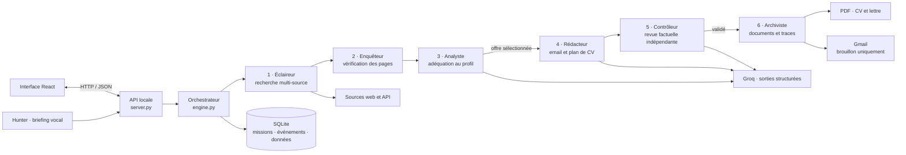
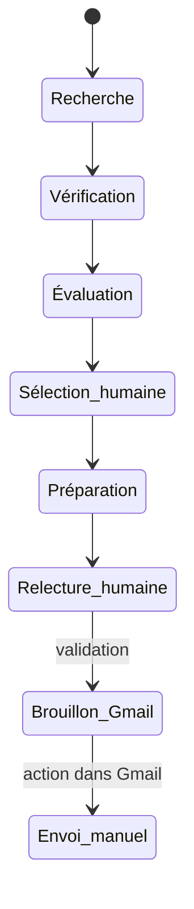

# LevelUp

### Une équipe d’agents IA pour transformer la recherche de stage en un pipeline clair, vérifiable et humainement contrôlé.

<p align="center">
  <a href="https://github.com/EyaDouiri/LevelUp"></a>
  
  
  
  
</p>

> **Projet portfolio — AI Agent Engineer**  
> Conçu pour explorer une question concrète : comment faire collaborer des agents spécialisés sur une tâche réelle, tout en gardant leurs décisions explicables, leurs données vérifiables et l’humain aux commandes ?

[Voir le code sur GitHub](https://github.com/EyaDouiri/LevelUp) · [Architecture détaillée](docs/architecture.mdx) · [Guide de démonstration](docs/demo-agentique-levelup.mdx)

---

## En un coup d’œil

LevelUp accompagne une campagne de recherche de stage de fin d’études en Data, IA et actuariat : il repère des offres, vérifie les sources, évalue leur adéquation à un profil, prépare des dossiers ciblés et conserve leur suivi. Les offres et les candidatures spontanées ont chacune leur parcours.

| 🔎 Découvrir | 🛡️ Vérifier | 🧠 Évaluer | ✍️ Préparer | 👤 Décider |
|:--|:--|:--|:--|:--|
| Sources web et entreprises cibles | Pages publiques et données disponibles | Correspondance profil / offre | CV, lettre et email | Validation et envoi Gmail manuels |

Le produit est un système **multi-agent orchestré** : les rôles, les relais, le journal d’activité et les reprises font partie de l’application. Ce n’est pas une conversation libre entre plusieurs LLM.

## L’architecture multi-agent, au centre



### Sept rôles distincts

| Rôle | Responsabilité | Exécution |
|:--|:--|:--|
| **Orchestrateur** | Lance les missions, contrôle leurs étapes, journalise les échanges et reprend les checkpoints. | Code Python · `engine.py` |
| **Éclaireur** | Cherche des offres et des entreprises à partir de sources configurées. | Adaptateurs et API · `providers.py`, `research.py`, `browse_jobs.py` |
| **Enquêteur** | Vérifie les URL publiques et extrait les informations disponibles, dont les données `JobPosting`. | HTTP et parsing déterministes · `research.py` |
| **Analyste** | Évalue la pertinence à partir de l’offre et du profil, avec motifs et informations manquantes. | LLM + contrat structuré · `engine.py`, `contracts.py` |
| **Rédacteur** | Prépare une candidature ciblée fondée sur les éléments du profil. | LLM + références de preuves · `engine.py` |
| **Contrôleur** | Passe en revue la candidature et bloque les affirmations non étayées. | Revue indépendante + validation par le code |
| **Archiviste** | Produit les documents et enregistre les résultats du dossier. | Code déterministe · `application_documents.py`, `storage.py` |

**Hunter** est l’interface de briefing vocal : il résume les données de campagne disponibles à la demande. Il complète l’équipe agentique sans remplacer son orchestrateur.

### Comment les agents travaillent ensemble

1. L’Orchestrateur construit une mission et la sauvegarde dans SQLite.
2. L’Éclaireur collecte les résultats ; la déduplication et la persistance s’effectuent au fil de la mission.
3. L’Enquêteur vérifie les fiches publiques et distingue les informations confirmées des informations manquantes.
4. L’Analyste compare l’offre au profil. L’humain choisit les dossiers à préparer.
5. Le Rédacteur prépare le contenu ; le Contrôleur le relit avant la génération des documents.
6. L’Archiviste produit le dossier. Après validation humaine, LevelUp peut créer un brouillon Gmail.

Chaque relais apparaît dans le journal de l’onglet **Équipe**. Les missions persistées peuvent reprendre après interruption.

## Un pipeline avec des garde-fous



- **Preuves traçables** : les éléments utilisés pour personnaliser une candidature sont reliés au profil.
- **Sorties structurées** : les échanges importants sont cadrés par des modèles Pydantic.
- **Pas d’envoi automatique** : Gmail reçoit un brouillon ; la personne relit, complète le destinataire et décide de l’envoi.
- **Reprise durable** : missions, événements et checkpoints sont enregistrés dans SQLite.
- **Données séparées** : offres publiques et candidatures spontanées suivent des parcours distincts.
- **Outils sous contrôle** : quotas configurables, cache de recherche, filtrage des URL publiques et interface locale.

## Fonctionnalités

- Tableau de bord des opportunités, des contacts et des entreprises cibles.
- Missions de recherche, suivi des étapes agentiques et reprise après interruption.
- Préparation de CV, lettre et email à partir des informations du profil.
- Candidatures spontanées à partir de contacts importés.
- Export Excel du suivi.
- Intégration Gmail OAuth pour créer des brouillons après validation.
- Hunter : briefing vocal en français sur l’état de la campagne.

## Stack

| Domaine | Technologies |
|:--|:--|
| Interface | React 19, Vite 8, JavaScript |
| Backend | Python, `http.server`, API JSON locale |
| Orchestration et contrats | Code Python, Pydantic v2, checkpoints SQLite |
| Recherche et vérification | httpx, Tavily, Adzuna, Jooble et connecteurs de sources optionnels |
| Raisonnement ciblé | Groq · réponses cadrées par des contrats applicatifs |
| Documents et suivi | ReportLab, openpyxl, Gmail API |
| Voix | Web Speech API côté navigateur ; services de synthèse configurables |

Les connecteurs disponibles dépendent de la configuration et de la disponibilité des sources. Une source en échec n’est pas une garantie de résultat ; vérifie toujours les fiches avant de candidater.

## Démarrer en local

### Prérequis

- Python 3.12 recommandé
- Node.js et npm pour construire l’interface
- Des clés API selon les sources et fonctions utilisées

```powershell
python -m venv .venv
.venv\Scripts\python -m pip install -r requirements.txt
Copy-Item .env.example .env
```

Renseigne dans `.env` uniquement les intégrations que tu souhaites utiliser, par exemple `GROQ_API_KEY` et `TAVILY_API_KEY`. Le service Gmail est optionnel et nécessite une configuration OAuth Google locale.

```powershell
cd frontend
npm install
npm run build
cd ..
.\start.ps1
```

L’interface est alors servie en local à `http://127.0.0.1:8000`. Pour lancer une mission depuis la ligne de commande :

```powershell
.venv\Scripts\python.exe main.py --max 6 --queries 8 --assess 8
```

Consulte [`.env.example`](.env.example) et le [guide](docs/guide.mdx) pour les options disponibles. **Ne committe jamais `.env`, `credentials.json` ou `token.json`.**

## Structure du projet

```text
LevelUp/
├── engine.py                 # Orchestration, missions, checkpoints et relais d’agents
├── contracts.py              # Contrats Pydantic pour les données d’agents
├── providers.py              # Adaptateurs de recherche et appels aux modèles
├── research.py               # Plan, vérification de fiches et extraction
├── browse_jobs.py            # Connecteurs de recherche complémentaires
├── application_documents.py   # Génération de CV et de lettres en PDF
├── gmail_gateway.py          # OAuth et création de brouillons Gmail
├── storage.py                # Persistance locale SQLite
├── server.py / api.py        # API HTTP locale
├── frontend/                 # Interface React et Vite
├── docs/                     # Guides, architecture et scénario de démonstration
└── tests/                    # Tests unitaires et scénarios d’interface
```

## Parcours de démonstration

1. Ouvre **Équipe** et lance une mission pour observer les agents et leurs relais.
2. Consulte le journal et les offres rapportées dans **Opportunités**.
3. Choisis un dossier, prépare les documents et vérifie les preuves utilisées.
4. Valide le dossier, puis crée un brouillon Gmail si OAuth est configuré.
5. Présente Hunter comme point d’entrée vocal vers l’état réel de la campagne.

Le [guide de démonstration](docs/demo-agentique-levelup.mdx) contient le fil narratif, les schémas métier et les limites à présenter.

## À propos de ce projet

LevelUp est un projet portfolio pour montrer une approche d’ingénierie agentique appliquée : responsabilités séparées, orchestration explicite, données persistées, sorties contrôlées et validation humaine. Il s’agit d’un assistant personnel en évolution, pas d’un service de recrutement ni d’une plateforme SaaS multi-utilisateur.

**Développé par Eya Douiri · Tunisie**  
[GitHub — EyaDouiri/LevelUp](https://github.com/EyaDouiri/LevelUp)
