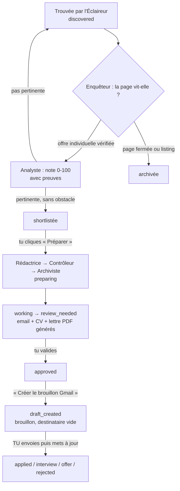
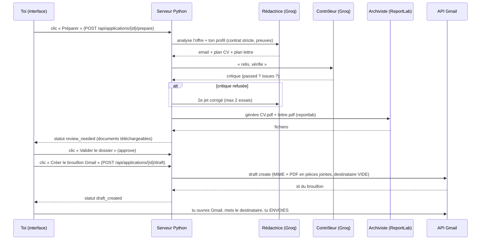

# Hunter × Hunter — Guide complet de la solution

> Document pédagogique et technique.
> Il explique **ce que fait la solution**, **comment elle fonctionne dans les moindres détails**,
> **comment l'utiliser au quotidien**, comment **configurer les emails**, et **à quelle fréquence la lancer**.
> Aucune pré-requis : chaque mot-clé est défini. Si tu veux la vue « briques techniques » seule, lis `docs/architecture.mdx`.
> Mis à jour le 16/09/2026.

---

## Sommaire

- **[A. Comprendre la solution sans être technique](#a--comprendre-la-solution-sans-etre-technique)**
- **[B. Utiliser la solution au quotidien](#b--utiliser-la-solution-au-quotidien)**
- **[C. L'automatisation des emails en détail](#c--lautomatisation-des-emails-en-detail)**
- **[D. Sous le capot (technique)](#d--sous-le-capot-technique)**
- **[E. À quelle fréquence lancer et planifier (cron / veille)](#e--a-quelle-frequence-lancer-et-planifier-cron--veille)**
- **[F. Dépannage](#f--depannage)**
- **[G. Aller plus loin](#g--aller-plus-loin)**

---

# A. Comprendre la solution sans être technique

## 1. En une phrase

> **Hunter × Hunter** est une **équipe d'agents IA qui travaillent pour toi, 24h/24, pour trouver des stages (PFE) sur mesure**, vérifier chaque offre en ligne, rédiger des candidatures prêtes à envoyer (email + CV + lettre de motivation), et les déposer dans ta boîte Gmail en **brouillon** — c'est toi qui décides toujours de l'envoi.

Le nom est un clin d'œil à l'animé *Hunter × Hunter* : tu es la **Chasseuse**, et ta petite équipe de chasseurs (les **agents**) part en mission pour toi.

## 2. L'analogie simple

Imagine que tu embauches une équipe de 7 personnes autour d'une table :

| Rôle | Qui fait quoi dans la vraie vie |
|---|---|
| **Chef d'équipe (Orchestrateur)** | Organise tout, vérifie que chacun fait son travail dans l'ordre, note chaque étape dans un cahier (la base de données). Seul lui a le droit de pointer les gens au travail. |
| **Éclaireur** | Part sur le web (Tavily + sites d'offres) chercher des offres de stage. Il revient avec des dizaines de fiches. |
| **Enquêteur** | Pour chaque fiche, va voir la page d'offre réelle : elle existe encore ? c'est un stage individuel ou une page de listing ? il note l'entreprise, la ville, le contrat, l'email. Il ne devine jamais : il vérifie. |
| **Analyste** | Note chaque offre **0 à 100** selon TA candidature (actuariat + data science, tes destinations, tes dates). Il doit fournir une preuve pour chaque point. |
| **Rédactrice** | Écrit l'email de candidature + choisit les arguments de ton CV + ta lettre de motivation, à partir des **seuls éléments vrais** dans ton profil. |
| **Contrôleur** | Relit le travail de la Rédactrice comme un relecteur indépendant. S'il trouve une absurdité, il renvoie le tout à la Rédactrice (au maximum 2 aller-retours). |
| **Archiviste** | Fabrique les fichiers PDF (CV + lettre), classe les documents, tient le journal de bord. |

**Et où es-tu, toi ?** En bout de chaîne, comme la chasseuse qui décide : tu **relis**, tu **valides**, tu **envoies**. Jamais l'IA n'envoie quoi que ce soit à ta place.

## 3. Les 3 promesses non négociables

1. **Aucune invention.** Si l'IA écrit « 2 ans d'expérience en modélisation actuarielle », c'est parce que la preuve existe dans TON profil (catalogue de preuves). Une preuve inventée → le système refuse et lève une erreur.
2. **Aucun envoi automatique.** La sortie finale est un **brouillon Gmail avec destinataire vide**, ou un fichier `.eml` à exporter. C'est TOI qui renseignes le destinataire et cliques envoi.
3. **Tout est reproductible.** Chaque étape est journalisée. Chaque mission a un *checkpoint* : si tu l'annules, si le réseau plante, si le quota tombe, tu peux **reprendre exactement là où ça s'est arrêté**, sans perte.

## 4. Le vocabulaire de base (à connaître)

| Mot | Définition |
|---|---|
| **Mission (run)** | Une session de travail de l'équipe : une « chasse » (recherche d'offres) ou une « préparation de dossier ». |
| **Offre (application)** | Une fiche de stage dans la base, avec un statut. |
| **Pipeline** | La liste de toutes les offres et leur progression : `discovered → shortlisted → prepared → approved → draft_created → applied → interview → offer / rejected`. |
| **Shortlist** | La liste restreinte des meilleures offres éligibles (L'Analyste les a notées haut, sans obstacle). |
| **Statut manuel** | Un statut que tu mets toi-même à la main (ex : « Entretien », « Refusée »). La machine ne l'écrase jamais. |
| **Quota / Budget** | Des compteurs journaliers et mensuels pour ne pas dépasser les limites gratuites des API. |
| **Checkpoint** | Point de sauvegarde d'une mission : permet la reprise sans recommencer. |

## 5. Le cycle de vie d'une offre (le grand schéma)



---

# B. Utiliser la solution au quotidien

## 6. Premier lancement (vérifie que c'est déjà fait)

La solution est déjà installée et configurée dans `C:\Users\eyaen\Desktop\Jamil\job-agent`. Pour la relancer à l'avenir :

```powershell
cd C:\Users\eyaen\Desktop\Jamil\job-agent
.\start.ps1
```

Puis ouvre **http://127.0.0.1:8000** dans ton navigateur.

Détails pour une installation propre de zéro :

```powershell
# 1. Environnement Python
python -m venv .venv
.venv\Scripts\python -m pip install -r requirements.txt

# 2. Clés API (copie puis remplis)
Copy-Item .env.example .env   # → mets TAVILY_API_KEY et GROQ_API_KEY

# 3. Frontend
cd frontend; npm install; npm run build; cd ..

# 4. Lance
.\start.ps1                   # → http://127.0.0.1:8000
```

> **100 % free tier.** Tavily (1000 recherches/mois) + Groq `openai/gpt-oss-20b` (LLM gratuit). Aucun abonnement payant n'est nécessaire.

## 7. La page de connexion

Depuis le rebranding, l'application s'ouvre sur une **page de connexion** au design Hunter × Hunter (flamme animée, effet machine à écrire, palette vert `#439e4e` / orange).

- **Mot de passe par défaut : `wakywaky`**
- L'accès reste mémorisé dans le navigateur (tu n'as pas à te réconnecter à chaque visite). Un bouton **« Se déconnecter »** est disponible en bas de la barre latérale (en rouge, comme toutes les actions destructives).

⚠️ **Statut honnête de cette sécurité** : le serveur n'écoute que sur `127.0.0.1` (ta machine uniquement) et refuse tout navigateur étranger (CORS strict). La page de connexion est une **porte de démo** : elle protège du regard et donne une vraie entrée « produit », mais ce n'est pas un chiffrement. Pour une vraie exposition publique, il faudrait un tunnel VPN, une authentification serveur (HTTP Basic / OAuth), ou un déploiement derrière un reverse proxy.

**Changer le mot de passe** : édite `frontend/src/App.jsx`, ligne `const PASSWORD = 'wakywaky'`, puis reconstruis le frontend :

```powershell
cd frontend
npm run build
```

## 8. La routine recommandée (l'essentiel)

La solution n'a besoin de toi que **quelques minutes par jour** :

1. **Lance une recherche** (ou laisse la **veille automatique** le faire — §E). L'Éclaireur part ramasser des offres, l'Enquêteur les vérifie, l'Analyste les note.
2. Ouvre **Opportunités**. Filtre, trie par « Meilleure adéquation ». Regarde le haut du classement : ce sont tes meilleurs chances.
3. Pour une offre qui te plaît : clique dessus → **Préparer**. Attends que la Rédactrice, le Contrôleur et l'Archiviste finissent (statut `À vérifier`).
4. **Relis le dossier** (email, CV PDF, lettre PDF). Éventuellement corrige le destinataire/objet/message.
5. **Valider le dossier** → **Créer le brouillon Gmail**.
6. Va sur Gmail, vérifie une dernière fois, mets le destinataire, et **envoie toi-même**.
7. Mets à jour le statut : `Envoyée`, puis `Entretien`, `Proposition`, `Refusée`… selon la suite.

## 9. Les 4 onglets de l'interface

| Onglet | À quoi sert-il |
|---|---|
| **Opportunités** | Le pipeline complet. Statistiques en haut (nombre d'offres, à vérifier, brouillons prêts, entretiens), recherche, filtres par statut/source, tri par adéquation. |
| **Équipe** | La vie des agents en direct : qui travaille sur quoi, le journal de mission (qui a fait quoi, transmis à qui, à quelle heure), la reprise d'une mission, les quotas consommés. |
| **Entreprises** | Tes sociétés cibles (« Priorité haute » → requêtes dédiées). |
| **Profil & limites** | Ton profil professionnel (poste, destinations, disponibilité, JSON complet) + les budgets + les connexions (Groq, Tavily, Gmail). |

## 10. Le suivi Excel (export + synchronisation)

Deux actions disponibles (routes `POST /api/excel/export` et `POST /api/excel/sync`), aussi utilisables en ligne de commande :

```powershell
# Export : écrit data/suivi_candidatures.xlsx (79 offres actuellement)
.venv\Scripts\python export_excel.py export

# Sync : relit le fichier Excel et réinjecte les statuts manuels dans la base
# (Rejeté → rejected, Clôturé → archived). SQLite est la vérité.
.venv\Scripts\python export_excel.py sync
```

Détails techniques du fichier :
- Colonne `Statut` protégée par une **liste déroulante** (validation de données) sur toute la plage.
- **Mise en forme conditionnelle** : lignes colorées selon le statut (Rejeté/Clôturé/Candidature envoyée…).
- **Ligne d'en-tête figée**, tri par ancienneté.
- Les statuts posés à la **main dans Excel ne sont jamais écrasés** par l'export.

## 11. L'assistant vocal **Waky Waky**

Le bouton flottant en bas à droite (orange) active la voix :
- Dis **« waky waky »** au micro (dans un navigateur Chrome/Edge) ou clique sur le bouton → l'assistant résume ta journée en français (top des offres, dernière mission) avec une synthèse vocale.
- C'est **gratuit** : la reconnaissance vocale (Web Speech API) et la synthèse (SpeechSynthesis) sont natives du navigateur ; seules les **phrases de synthèse** sont générées par Groq (`GET /api/voice`, avec repli automatique si Groq est indisponible).

---

# C. L'automatisation des emails en détail

## 13. Question directe : est-ce que c'est fait avec n8n ?

**Non.** Il n'y a **aucun n8n**, Zapier, Make, ni orchestrateur externe dans le projet.

L'automatisation (recherche → vérification → analyse → rédaction → brouillon Gmail) est **100 % codée en Python**, dans les modules du projet (`engine.py`, `providers.py`, `research.py`, `application_documents.py`, `gmail_gateway.py`…), servie par un serveur HTTP de la bibliothèque standard Python. Les agents s'appellent **en mémoire vive (threads)**, pas via des webhooks.

**Pourquoi ce choix ?**
- **Zéro abonnement** : pas de plan n8n payant, pas de moisson de workflows.
- **Zéro dépendance réseau** : si Internet coupe ou qu'une API externe ferme, le cœur continue.
- **Tout reste local et débogable** : chaque étape est un appel de fonction Python, testé par 85 tests automatisés.

**Ce que n8n ferait différemment** : il remplacerait le « câblage » des étapes par des nœuds visuels. C'est séduisant pour des non-codeurs, mais ça ajoute un outil de plus à maintenir et à héberger, et ça complique la garantie « pas d'envoi automatique » (un nœud d'envoi mal branché = un email parti sans consentement).

## 14. Le flux complet d'un email, étape par étape



Points techniques à retenir :
- Le brouillon est créé via l'API Google (`gmail.users().drafts().create()`), **scope `gmail.compose` uniquement** : il est techniquement impossible à cette application d'envoyer un message.
- Si un brouillon existe déjà pour l'offre, il est **mis à jour** (pas de doublon).
- Un statut `draft_pending` protège contre la double création : si Gmail ne confirme pas, aucune nouvelle tentative automatique (tu vérifies ta boîte et tu relances).
- L'email inclut **CV + lettre de motivation** en PDF générés par l'Archiviste.

## 15. Configurer Gmail pas à pas (une seule fois)

**Pré-requis** : un compte Google (le tien). Étape à faire une fois, elle est valable pour toute la campagne.

1. **Créer un projet dans Google Cloud Console** (console.cloud.google.com) → Nouveau projet.
2. **Activer l'API Gmail** : « API Gmail » → Activer.
3. **Créer un OAuth consent screen** (Écran de consentement OAuth) :
   - Type : **Externe** (même pour usage seul).
   - Ajoute-toi comme **test user** (ton adresse Gmail).
   - Scopes : non requis à l'écran, ajoutés par le code.
4. **Créer des identifiants OAuth 2.0** → Type d'application : **Application de bureau** → Télécharger le JSON → renomme-le **`credentials.json`** et place-le à la racine du projet (`C:\Users\eyaen\Desktop\Jamil\job-agent\credentials.json`).
5. Dans `.env`, vérifie `GMAIL_CREDENTIALS_PATH=credentials.json` (déjà le cas).
6. Dans l'application, onglet **Profil & limites → Connecter Gmail**. Une fenêtre Google s'ouvre : autorise. Un fichier **`token.json`** est créé à la racine (ne jamais le partager ni le commiter).
7. Le rang « Gmail » passe à **Connecté** dans l'interface.

**Récapitulatif des deux fichiers** :

| Fichier | Rôle | Secret ? |
|---|---|---|
| `credentials.json` | Identifiants OAuth **publics** de ton application (client ID/secret) | Techniquement oui mais conçu pour être distribué |
| `token.json` | Ton **jeton d'accès** personnel à ton Gmail | **OUI — ne jamais le partager ou le commiter** |

## 16. Garantie absolue : jamais d'envoi automatique

- Le scope OAuth est `gmail.compose` : créer et modifier des brouillons, **rien d'autre**. L'envoi (`gmail send`) n'existe pas dans le code.
- Le brouillon part avec un **destinataire vide**. C'est un garde-fou humain : tu ne peux pas envoyer par erreur un message à quelqu'un que tu n'as pas choisi.
- Même si tout cassait, la route d'export `.eml` (`GET /api/applications/{id}/export.eml`) te permet de récupérer l'email complet avec pièces jointes sans connexion Gmail du tout.

## 17. Sans Gmail du tout : l'export `.eml`

Tu n'as pas envie d'autoriser l'OAuth ? Aucun problème :

1. Prépare et valide le dossier normalement.
2. Dans le dossier, clique **« Exporter .eml »**.
3. Ouvre le fichier dans Outlook/Thunderbird/Apple Mail, mets le destinataire, envoie. Tout le contenu (texte + PDF joints) est là.

## 18. Limites du free tier et gestion

| Ressource | Quota gratuit | Limite appliquée par l'app |
|---|---|---|
| Tavily (recherche web) | 1000 recherches/mois | `daily_search_limit` = 16/jour, `monthly_search_limit` = 800/mois |
| Groq (LLM : Analyste, Rédactrice, Contrôleur) | Free tier | `daily_llm_limit` = 40/jour, throttling 45 s entre appels |
| Gmail API (brouillons) | ~250 unités/seconde, généreux | Aucune limite codée ; un brouillon par offre |

Quand un quota est atteint, la mission passe en `budget_paused` : **tout est préservé**, tu reprends le lendemain (`Resume`). Les limites se règlent dans **Profil & limites** sans toucher au code.

---

# D. Sous le capot (technique)

## 19. La tour d'architecture

```mermaid
flowchart LR
    U[React 19 + Vite] -->|JSON HTTP| API[server.py ThreadingHTTPServer]
    API --> E[engine.py — Orchestrateur (Team)]
    E --> R[research.py — plan + Enquêteur]
    E --> P[providers.py — adaptateurs]
    P --> T[Tavily]
    P --> A[Adzuna / Jooble]
    P --> B[browse_jobs.py — Stage.fr / WTTJ]
    E --> G[providers.structured → Groq]
    E --> D[application_documents.py → PDF]
    E --> GM[gmail_gateway.py → brouillon Gmail]
    E --> S[(storage.py — SQLite WAL)]
```

- **Backend** : Python 3.12, **aucun framework web** (le `http.server` standard — zéro dépendance lourde).
- **Frontend** : React 19, buildé par Vite dans `frontend/dist/`, servi par le même serveur Python.
- **Base** : SQLite en mode WAL (`data/jamil.sqlite3`), avec verrou atomique et **une seule mission active à la fois** (index unique partiel).
- **IA** : Groq `openai/gpt-oss-20b` uniquement là où il faut du jugement. Tout le reste (dédup, vérification, budgets, PDF) est **déterministe**.

## 20. Comment une mission est-elle orchestrée ?

1. `Team.start("hunt", {max})` crée une mission `queued` en base et lance un **thread** (`daemon`).
2. `search_plan()` (round-robin France → Belgique → Suisse → Tunisie × vocabulaire × année ; ~75 % Tavily, ~25 % browse direct) génère les requêtes.
3. L'Éclaireur exécute chaque requête → chaque résultat est **sauvegardé avant la requête suivante** (checkpoint) → rien n'est perdu.
4. L'Enquêteur vérifie les offres prioritaires **en parallèle (3 threads)** : 404 → fermée, 403/challenge → `snippet_only` (score provisoire), JSON-LD `JobPosting` → on extrait titre/ville/entreprise/date, page avec plusieurs postings → listing.
5. L'Analyste note 0-100 avec **catalogue de preuves vérifié** (une `evidence_id` hors catalogue → erreur, pas de note).
6. L'Orchestrateur shortliste le top N éligibles et prévient l'humain.

Reprise : `resume()` accepte `interrupted | cancelled | failed | budget_paused | partial`. Au redémarrage du serveur, `recover()` ramène les missions en cours à `interrupted`.

## 21. Les routes principales de l'API (pour le curieux / l'intégration)

```
GET    /api/overview                  → instanite complète (offres, missions, budgets, connexions)
GET    /api/voice                     → point du jour vocal (Groq, avec repli)
GET    /api/applications              → liste des offres
POST   /api/run                       → lancer une mission hunt
POST   /api/runs/{id}/cancel|resume   → gérer une mission
POST   /api/applications              → import manuel d'une offre
PATCH  /api/applications/{id}         → notes / email / statut manuel
POST   /api/applications/{id}/prepare → lancer la rédaction du dossier
POST   /api/applications/{id}/approve → validation humaine
POST   /api/applications/{id}/draft   → brouillon Gmail
GET    /api/applications/{id}/export.eml → email complet à exporter
GET    /api/artifacts/{id}/{rev}/{file}.pdf → documents générés
PUT    /api/profile                   → profil (validé, strict)
PATCH  /api/settings                  → budgets + veille automatique
POST   /api/companies                 → sociétés cibles
POST   /api/excel/export|sync         → suivi Excel
POST   /api/gmail/connect             → lancer le flux OAuth Gmail
```

## 22. Les compteurs, le cache et le throttling

- Deux compteurs de budget dans SQLite : `search` et `llm`, réservés **atomiquement** (`BEGIN IMMEDIATE`) pour éviter les dépassements en parallèle.
- Cache Tavily 20 min en base (une même recherche n'est pas re-facturée).
- 45 s minimum entre deux appels LLM (free tier Groq).

## 23. Vérifier que tout va bien (tests)

```powershell
cd C:\Users\eyaen\Desktop\Jamil\job-agent
.venv\Scripts\python -m unittest discover -s tests -q
```

Doit afficher **`Ran 85 tests ... OK`** (0 échec, 0 skip). Ce sont les garanties anti-hallucination, anti-SSRF, budget atomique, dédup concurrente, routes Excel et voix — testées.

---

# E. À quelle fréquence lancer, et planifier (cron / veille)

## 24. Réponse courte

> Pour une recherche de PFE qui démarre en janvier 2027 et des offres qui tombent au fil de l'eau, **une mission par jour suffit largement**. Tu peux soit lancer à la main quand tu t'ouvres l'appli, soit activer la **veille automatique** intégrée qui le fait pour toi, sans cron, sans rien installer.

## 25. Réponse raisonnée

| Situation | Fréquence conseillée | Pourquoi |
|---|---|---|
| Veille d'entretien active | **1×/jour** (garder aussi une après-midi pour postuler) | Les offres de stage ont des fenêtres de quelques jours à quelques semaines |
| Recherche active de PFE | **1×/jour ou 1×/2 jours** | Ça suffit à ne rater aucune opportunité sur les sources connectées |
| Rafraîchir seulement avant une grosse vague (sept. → déc.) | **2-3×/semaine** puis quotidien | Les missions avalent des quotas gratuits : inutile de les brûler |

Ne pas oublier : **une seule mission en même temps**. Si la veille tourne déjà, lancer à la main n'arrivera pas au-dessus (et si ta recherche est très active, tu augmentes les quotas dans Profil & limites).

## 26. Option 1 — la veille automatique intégrée (recommandée, zéro config système)

Le serveur lance un thread de fond qui **passe toutes les 30 secondes** et déclenche une mission `hunt` **une fois par jour** quand les conditions sont réunies :

```python
# engine.py (extrait réel)
while not self.stop.wait(30):
    settings = self.store.settings()
    if not settings["auto_watch"] or hour < settings["watch_hour"] or already done today:
        continue
    self.start("hunt", {"max": 8, "scheduled": True})
```

**Pour l'activer** : onglet **Profil & limites** → coche **« Veille automatique »** → choisis l'**heure de veille** (serveur) → Enregister.
Le serveur doit tourner à cette heure-là (ton PC allumé, ou le PC/Tee si tu héberges sur une machine qui dort peu — voir §27).

## 27. Option 2 — un vrai cron / Planificateur de tâches Windows

La veille intégrée nécessite le **serveur démarré** (et un PC allumé). Si tu veux une exécution même à heure fixe, deux solutions complémentaires :

**a) Planificateur de tâches Windows (le plus simple pour toi)** — lance la CLI qui exécute une mission sans interface :

```powershell
# 1. Panneau de configuration → Outils d'administration → Planificateur de tâches
# 2. Créer une tâche quotidienne, déclencheur à l'heure voulue
# 3. Action : « Démarrer un programme »
#    Programme   : C:\Users\eyaen\Desktop\Jamil\job-agent\.venv\Scripts\pythonw.exe
#    Arguments   : "C:\Users\eyaen\Desktop\Jamil\job-agent\main.py" --max 8
#    Démarrage   : C:\Users\eyaen\Desktop\Jamil\job-agent
```

**b) Cron Linux** (si tu déploies sur un petit serveur) :

```bash
# Execute la chasse chaque jour à 09h05
5 9 * * * cd /path/to/job-agent && .venv/bin/python main.py --max 8 >> logs/hunt.log 2>&1
```

La CLI `main.py` (déjà dans le projet) crée la mission et l'exécute **en premier plan**, sans serveur ni navigateur.

> ⚠️ Le cron **n'est pas nécessaire** au fonctionnement quotidien : c'est un confort pour automatiser le déclenchement. La recherche elle-même reste à chaque fois gratuite dans les limites fixées.

## 28. Où surveiller (monitoring léger)

- **Onglet Équipe** : l'activité des 7 agents en direct, le journal, la consommation des quotas (barres de progression), l'état de la mission.
- **Onglet Opportunités** : combien d'offres sont arrivées, combien en attente de validation.
- **`GET /api/status`** : la mission courante + erreurs (pour un script de supervision).
- **`data/jamil.sqlite3`** : toute la vérité. Sauvegarde simple :

```powershell
python -c "import sqlite3 as s; s.connect('data/jamil.sqlite3').backup(s.connect('backup/jamil_backup.sqlite3'))"
```

---

# F. Dépannage

## 29. Symptômes et solutions

| Symptôme | Cause probable | Solution |
|---|---|---|
| La page ne s'ouvre pas | Serveur arrêté / port occupé | Relance `.\start.ps1`. `JAMIL_PORT` change le port (8000 par défaut). Vérifie la console pour les erreurs. |
| « Gmail non connecté » mais tu avais autorisé | `token.json` supprimé/fichier corrompu, ou compte changé | Re-clique « Connecter Gmail » (`POST /api/gmail/connect`) ; sinon supprime `token.json` et refais le flux. |
| « credentials.json OAuth Google absent du projet » | Fichier non présent à la racine | Suis §15.4 et place `credentials.json` à la racine avec `GMAIL_CREDENTIALS_PATH=credentials.json` dans `.env`. |
| « Gmail n'a pas confirmé la création » | Réseau instable, quota Google, token expiré | Vérifie ta boîte (un brouillon a peut-être été créé), puis re-essaie. Le verrou `draft_pending` empêche les doublons/doubles tentatives. |
| Stage.fr « 403 Access denied » (source non collectée) | Protection WAF du site face aux bots | Connu et non bloquant : la mission continue, les autres sources fonctionnent. Voir roadmap §32. |
| Jooble jamais utilisé | Clés par pays absentes | Crée une clé par pays (fr.jooble.org/api/about, be., ch.) et mets `JOOBLE_API_KEY_FR/_BE/_CH` dans `.env`. |
| Mission `budget_paused` | Quota atteint | Attends le lendemain (ou l'heure), puis `Resume`. Tout est sauvegardé. |
| Un email semble faux dans le dossier | La Rédactrice a extrapolé malgré le contrôle | Signale-le dans le dossier, corrige manuellement (champs éditables), ou re-Prépare après avoir mis à jour le profil. |
| Mot de passe de la page de connexion oublié | — | `const PASSWORD = 'wakywaky'` dans `frontend/src/App.jsx`, puis `npm run build`. |
| La base semble avoir des offres obsolètes | Des anciennes offres France Travail sont conservées volontairement | Elles restent visibles et distinctes (source « France Travail »). Les nouvelles missions ne collectent plus sur ce canal. |

## 30. Erreurs d'application fréquentes (messages)

- **« Le dossier doit etre prepare puis relu. »** → il faut lancer « Préparer » puis valider avant d'accéder au brouillon.
- **« L'objet et le corps de la candidature sont requis. »** → email vide ; corrige dans le dossier.
- **« Ton profil a change : prepare une nouvelle version du dossier. »** → profil modifié après préparation → les documents ne sont plus à jour ; re-Prépare.
- **« Ton profil a change depuis la preparation. »** → idem côté brouillon Gmail.
- **« Creation Gmail au resultat incertain… »** → voir §29/« Gmail n'a pas confirmé ».

---

# G. Aller plus loin

## 31. Ce qui reste à améliorer (état au 16/09/2026)

1. **Stage.fr 403 WAF** : contournement à étudier (headers / navigation) — décider si ça vaut le coup.
2. **WTTJ** : valider le fallback Playwright en live.
3. **Clés Jooble par pays** : à récupérer pour activer cette source.
4. **Authentification réelle** : si mise en ligne, ajouter une vraie couche serveur (Basic Auth / OAuth) au lieu du portail de démo.
5. **Export/suivi Excel** : déjà fonctionnel (79 offres, formules conditionnelles, sync bidirectionnel).

## 32. Glossaire express

| Terme | Sens |
|---|---|
| **Agent** | Un « employé IA » avec un rôle précis (Éclaireur, Analyste…) |
| **Mission / run** | Une session orchestrée de l'équipe (chasse ou préparation) |
| **Checkpoint** | Sauvegarde incrémentale d'une mission, reprise sans perte |
| **Quota / budget** | Limites gratuites journalières/mensuelles des API |
| **Shortlist** | Classement restreint des meilleures offres éligibles |
| **Snippet** | Extrait de la recherche web ; utilisé en solution de repli si la page est bloquée (score provisoire) |
| **Dédup** | Détection des doublons (URL canonique, paramètres de tracking supprimés) |
| **Catalogue de preuves** | Le contenu TON profil transformé en références vérifiables (`exp:i`, `project:i`, `skill:key`) |
| **SSRF** | Faille de sécurité serveur ; bloquée (IP privées et DNS internes refusés) |
| **WAL** | Mode d'écriture SQLite permettant lectures pendant écritures |
| **CORS** | Règle du navigateur ; ici seulements les origines localhost sont acceptées |

---

*Fin du guide — relis la section [C](#c--lautomatisation-des-emails-en-detail) si l'email reste flou, la section [E](#e--a-quelle-frequence-lancer-et-planifier-cron--veille) pour la fréquence, et `docs/architecture.mdx` pour la vue architecturale complète.*